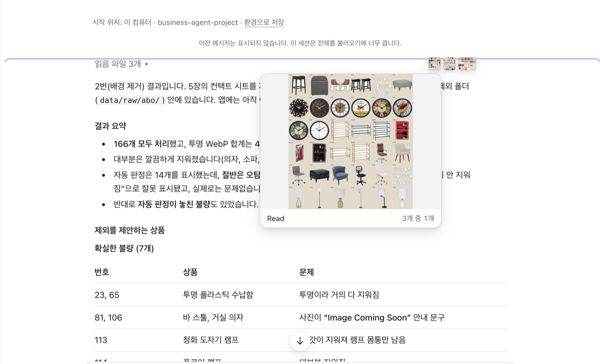
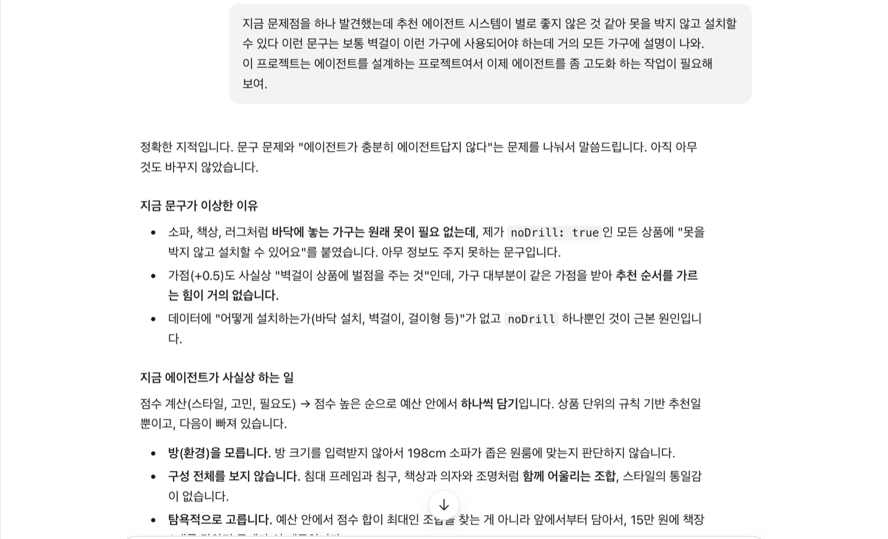
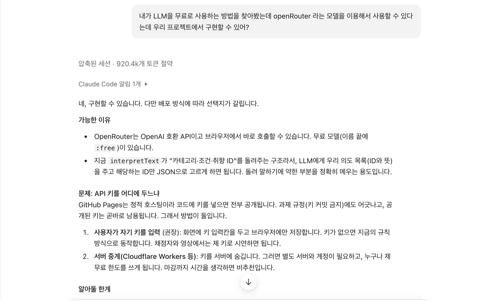
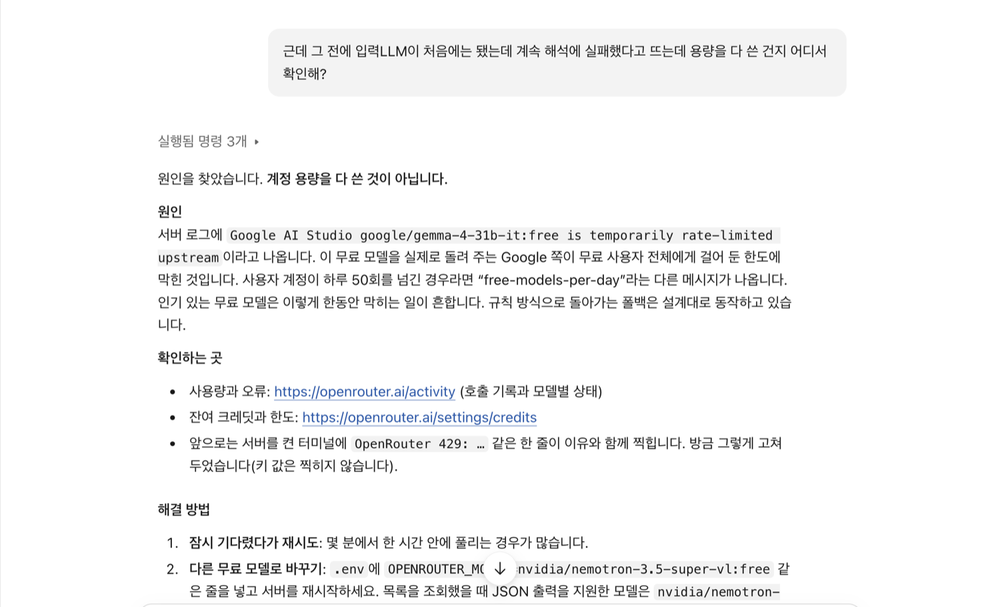

# 자취방 꾸미기 에이전트

 본 프로젝트는 고려대 세종캠퍼스 주변 자취생을 위한 모바일 대응 웹 서비스입니다. 취향과 예산을 알려 주면 에이전트가 가구·소품 후보를 점수 순으로 보여 주고, 사용자가 직접 담아 예산을 맞춘 뒤 **내 방 사진 위에 올려 볼 수 있습니다.**

## 목적과 사용자

인테리어 경험이 없고 예산이 한정된 자취생이 "무엇을 얼마에 사야 하는지" 막막한 문제를 다룹니다. 추천에는 고른 분위기, "아쉬운 점", 직접 쓴 고민, 방 크기, 예산을 씁니다. 예를 들면 퇴실 때 원상복구가 걱정되면 "벽에 못을 박기 어려워요" 조건으로 벽걸이 상품을 뺍니다.

## 실행 방법

필요한 것은 **Python 3와 웹 브라우저**뿐입니다(설치할 패키지 없음).

```bash
git clone https://github.com/baegoseong/business-agent-project.git
cd business-agent-project
python3 tools/dev_server.py
```

브라우저에서 `http://localhost:8765/index.html`을 엽니다. 키 없이 모든 기능이 동작하며 화면은 4단계입니다.

1. **방 정보**: 사진, 방 크기, 예산, 이미 있는 가구(모두 선택)
2. **취향**: 방 분위기 사진(오늘의집 스타일 8개) 고르기, 아쉬운 점, 조건, 카드에 없는 고민 직접 쓰기
3. **추천 상품 고르기**: 카테고리별 후보 담기, 합계와 예산 확인, "예산에 맞춰 자동 선택"
4. **내 방에 올려 보기**: 사진 위에서 끌어 옮기고 핸들로 크기·회전·삭제, PNG 저장

**선택: AI 글 해석.** `.env.example`을 `.env`로 복사해 OpenRouter 키를 넣고 서버를 다시 켜면 2단계의 글을 무료 모델로도 읽습니다(`OPENROUTER_MODEL`로 모델 지정). 키는 서버만 읽고(`.env`는 git 제외) 브라우저로 나가지 않으며, 키가 없거나 실패하면 규칙 방식으로 동작합니다.

**검증 명령(선택).** 에이전트 테스트는 macOS의 JavaScriptCore(`jsc`)로 돌립니다.

```bash
python3 tools/validate_data.py     # 데이터 검사: OK: all checks passed
python3 tools/test_server.py       # 서버 테스트: ALL PASSED
JSC=/System/Library/Frameworks/JavaScriptCore.framework/Versions/A/Helpers/jsc
$JSC tools/test_agent.js           # 에이전트 테스트: ALL PASSED
$JSC tools/eval_text.js            # 정확도 표
```

## 핵심 파일 (5개)

| 파일 | 역할 |
|---|---|
| `agent/agent.js` | 글 해석, 취향 진단, 점수화, 예산 안 자동 선택 |
| `app.js` | 4단계 화면 흐름, 예산 계산, 되묻기 화면 |
| `overlay.js` | 사진 위 배치(Canvas, 드래그, 핸들) |
| `tools/test_agent.js` | 에이전트 테스트(124개 검사) |
| `tools/eval_text.js` | 글 해석 정확도 측정 |

## 데이터와 출처

상품은 공개 데이터셋 **Amazon Berkeley Objects(CC BY 4.0, Amazon.com)** 에서 가져왔습니다. **ABO에는 가격이 없어 가격은 추정값**이며 화면에 그렇게 표시합니다. 방 분위기 사진 8장은 **Pexels**(Pexels License) 사진이고 작가는 화면과 `data/moods.json`에 있습니다.

정제: 후보 166개를 골라 한글로 옮기고 흰 배경을 지워 투명 WebP로 바꿨습니다(불량 13개 제외, 153개). 수집 스크립트는 제출물에서 뺐고 git 기록에 있습니다(항목은 `docs/data-schema.md`).

## 작업 과정

1. **데이터가 가장 큰 난관일 것 같아 먼저 확인했습니다.** 가구 데이터 확보가 가장 어려워, AI에게 테스트용 가구(직접 그린 SVG 23개)를 만들게 하고 웹 구성을 먼저 다져 본 뒤 주제로 괜찮은지 판단했습니다. 괜찮다고 보고 공개 데이터셋 ABO에서 실제 상품을 수집해 정제했습니다.
2. **가구를 올려 볼 방식을 정했습니다.** 방 사진 위에 올리는 2D 방식으로 시작했고, 아쉬워서 3D 스캔과 영상 프레임 캡처도 구현해 봤지만 효율이 떨어져 2D로 되돌렸습니다.
3. **정제한 데이터에 맞춰 취향 추천 에이전트를 만들었습니다.**
4. **테스트와 검증으로 부족한 점을 채웠습니다.** 글 해석이 약하다는 측정 결과가 나와 무료 LLM(OpenRouter)을 **선택 기능**으로 붙였고, 화면은 "자취방 벽" 콘셉트로 다시 꾸몄습니다. README는 작업 중간중간 기록하다가 마지막에 다듬었습니다.

## Claude Code 증거와 검증 결과


1. **데이터 정제**: 배경 제거 결과를 눈으로 확인해 자동 판정의 오탐과 놓친 불량을 찾았습니다.


2. **에이전트 개선**: 모든 가구에 "못 없이 설치 가능"이 붙는 문제를 짚고 원인(설치 방식 데이터 없음)을 분석했습니다.


3. **LLM 도입 검토**: 무료 LLM(OpenRouter)과 API 키 공개 문제를 따져 키를 서버에만 두기로 했습니다.


4. **오류 검증**: AI 해석 실패 원인을 로그로 확인했습니다(계정 한도가 아닌 모델 제공처 한도).

- **데이터 검증**(`validate_data.py`): 필드, 값 범위, 이미지 파일, 가격 관계, 출처를 검사합니다.
- **에이전트 테스트**(`test_agent.js`) 124개와 서버 테스트(`test_server.py`, 키 보호·실패 처리) 10개가 통과합니다.
- **AI 해석 검증**: 앞 테스트에 AI 결과 변환 검사 8개(없는 항목 걸러내기, 부정 처리, 규칙 방식 대체)가 들어 있습니다. 실제 모델에 직접 입력하며 문제 4개를 찾아 고쳤습니다: 빈 응답, 한도 초과(429), "어두운 분위기"를 조명으로 오해, "공간활용" 미인식. 정확도는 측정하지 못했습니다.

| 케이스 | 결과 |
|---|---|
| 예산 15만 원 | 4개 추천(144,000원), 수납은 최대 2개 |
| 예산 200만 원 | 22개 카테고리 모두 추천 |
| 예산 6만 원 | 57,500원 안에서 3개 |
| **엣지**: 예산이 최저가(8,500원)보다 적음 | 추천 0개, 필요한 금액 안내 |
| **엣지**: 모든 카테고리 보유 | "추천할 게 없음" |

**글 해석 평가**(`eval_text.js`): 2단계에 직접 쓴 글을 얼마나 알아듣는지 쟀습니다. 제가 만든 문장·정답(카테고리·조건·취향)과 비교했고 점수(F1)는 높을수록 정확합니다. 규칙도 제가 썼으므로 **독립된 평가가 아닙니다.**

| 시험한 문장(개수) | 예 → 정답 | 처음 규칙 | 규칙 보강 | +글자 유사도 | +되묻기* |
|---|---|---|---|---|---|
| 일상 문장(42) | "퇴근하고 오면 방이 캄캄해서 우울해요" → 조명 | 59% | 70% | 71% | 73% |
| 돌려 말한 문장(24) | "해가 지면 방 안이 잘 안 보여요" → 조명 | 0% | 9% | 9% | 28% |

두 세트 모두 **규칙을 고치기 전에** 잰 점수입니다(고친 뒤의 97~100%는 같은 문장을 보고 고친 것이라 **의미가 없어** 뺐습니다). 규칙 보강은 부정·구체어 우선 처리, 글자 유사도는 예시 문장과의 비교이며, *되묻기는 애매하면 사용자에게 확인하는 단계(알맞게 고른다고 가정한 상한선)입니다.

## 효과적이었던 방법 3가지

1. **AI의 작업이 끝나면 눈으로 직접 확인했습니다.** 내가 요청한 말과 AI가 받아들인 말은 다를 수 있어, 배경 제거 결과나 평가 점수처럼 AI가 낸 결과를 그대로 믿지 않고 직접 검증했습니다.
2. **작업 전에 AI의 이해 내용을 보고받았습니다.** AI에게 일을 막 시키면 모르는 곳이 바뀌어 프로젝트에 영향이 갈 수 있어, 요청을 어떻게 알아들었는지, 수정할 목록, 영향 범위를 먼저 보고받았습니다.
3. **다음 할 일을 미리 말해 두었습니다.** 작업을 중간에 멈추거나 다음 날 이어 할 때 계획을 미리 정리해 두면 효율적으로 이어갈 수 있었습니다.

## 어려웠던 점 3가지

1. **실제 가구 데이터 확보.** 쇼핑몰은 API가 없고 크롤링은 약관 문제가 있었습니다. → 공개 데이터셋 ABO. *남은 문제: 가격은 추정값.*
2. **이미지 품질.** 흰 상품이 배경에 지워지고 가구 안쪽 흰 구멍이 남았습니다. → 갇힌 영역 제거, 불량 13개 제외. *남은 문제: 롤 이불 밑 흰 띠.*
3. **자유 문장 이해.** 규칙 보강으로 59%→70%를 올렸지만 **돌려 말하기는 9%**에 그쳤습니다. → 애매하면 되묻고, 못 알아들은 표현은 숨기지 않고 알립니다. *남은 문제: 진짜 이해는 LLM이 필요합니다.*

## 알려진 한계

- **키가 없으면 직접 쓴 글은 규칙과 글자 유사도로 해석**해 돌려 말하기에 약합니다. AI 해석은 서버와 키가 있을 때만 켜지며 무료 모델은 호출 한도(분당 20회, 하루 50회)가 작습니다.
- **AI도 정해 둔 항목 35개 안에서만 고릅니다.** 항목에 없는 요구(예: 이사가 잦아 가벼운 가구)는 "반영하지 못한 표현"으로 알리고 추천에 쓰지 않습니다. 모델이 목록 밖의 말을 지어내지 못하게 한 선택입니다.
- 오늘의집 스타일 8개를 우리 취향 4가지(미니멀·모던·우드·따뜻한)로 **근사 환산**했고, 상품의 스타일은 상품명 키워드로 자동 분류해 부정확할 수 있습니다.
- 방 크기는 "바닥의 절반까지 가구를 둘 수 있다"고 가정하며, 사진 합성에는 원근감이 없습니다.
- 러그·소품은 후보가 적고 커튼·빈백은 없습니다.
